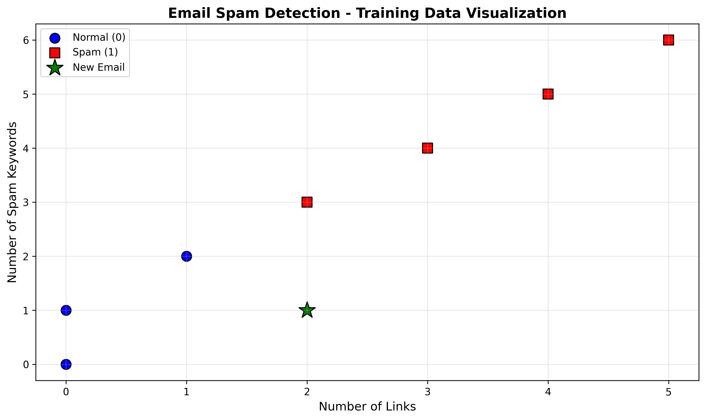

# Machine Learning appliqué à la cybersécurité

Travaux pratiques de Machine Learning en Python : de la régression linéaire jusqu'à un **système de détection d'intrusion (IDS) par réseau de neurones** entraîné sur le jeu de données NSL-KDD.

## Travaux pratiques

| TP | Fichier | Sujet |
|----|---------|-------|
| 1 | [`tp1_regression_lineaire.py`](tp1_regression_lineaire.py) | Régression linéaire avec scikit-learn : génération de données, entraînement, paramètres du modèle |
| 2 | [`tp2_knn.py`](tp2_knn.py) | Classification par k plus proches voisins (KNN) |
| 2 | [`tp2_knn_spam.py`](tp2_knn_spam.py) | KNN appliqué à la détection de spam (nombre de liens, mots-clés suspects) · [réponses](tp2_knn_spam_reponses.md) |
| 3 | [`tp3_knn_detection_trafic.py`](tp3_knn_detection_trafic.py) | Détection de trafic malveillant (taille des paquets, durée de connexion) : normalisation, K = 1/3/5, distances euclidienne et Manhattan |
| 4 | [`tp4_ids_nsl_kdd.py`](tp4_ids_nsl_kdd.py) | IDS par réseau de neurones sur **NSL-KDD** : comparaison d'une architecture peu profonde et d'une architecture profonde · [rapport](tp4_ids_nsl_kdd.md) |

<p align="center">
  
</p>

## Installation

```bash
pip install -r requirements.txt
```

## Exécution

```bash
python tp3_knn_detection_trafic.py
python tp4_ids_nsl_kdd.py   # télécharge NSL-KDD automatiquement
```

## Technologies

Python · NumPy · pandas · scikit-learn · TensorFlow / Keras · Matplotlib
